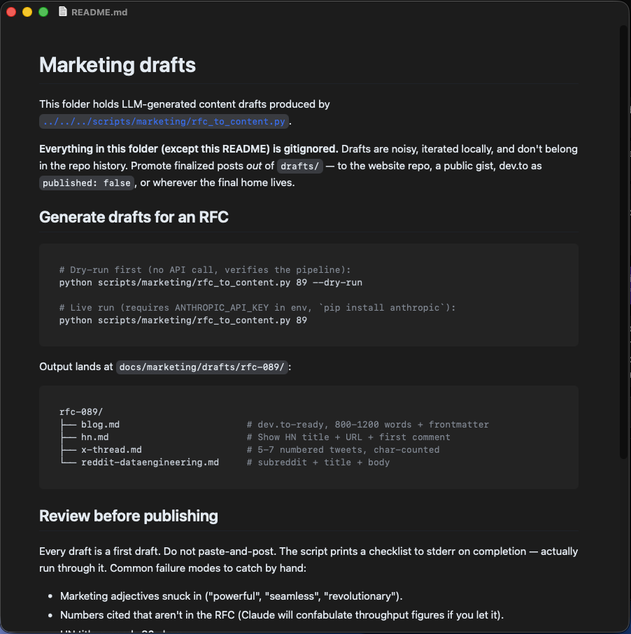

# Markus

> A small, fast, native macOS Markdown editor with GitHub-style preview.

<p align="center">
  
</p>

## What it does

Native macOS Markdown editor. Document-based: open `.md` / `.markdown`, edit,
and preview with GitHub-flavored rendering (marked + highlight.js).

## Requirements

- macOS 13+
- [XcodeGen](https://github.com/yonaskolb/XcodeGen)

## Quickstart

```bash
brew install xcodegen
git clone https://github.com/nightmoose/Markus.git
cd Markus
xcodegen generate
open Markus.xcodeproj    # then Run (Cmd-R)
```

## Build

```bash
xcodegen generate
open Markus.xcodeproj
```

Bundle id is `com.nightmoose.markus`. Signing: Automatic. Select your own team in Xcode, and change the bundle id in `project.yml` if you sign under a different team (also update `set-default.swift`).

## Usage

Double-click any `.md` file, or File > Open. Edit on one side and see the rendered preview, with syntax-highlighted code blocks and light/dark themes. To make Markus the default app for Markdown, run `swift set-default.swift --set`; run it with no flag to see the current handler, optionally passing a `.md` path.

## Layout

```
Sources/App          SwiftUI document + preview
Sources/Resources    CSS/JS preview bundle, app icon
project.yml          XcodeGen spec
make-icon.swift      Iconset helper
set-default.swift    Set/inspect the default Markdown handler
```

Bundled third-party code is listed in [THIRD_PARTY_NOTICES.md](./THIRD_PARTY_NOTICES.md).

## License

[MIT](./LICENSE) © 2026 NightMoose, Inc.
